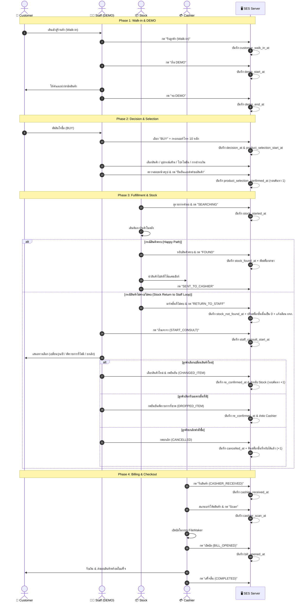
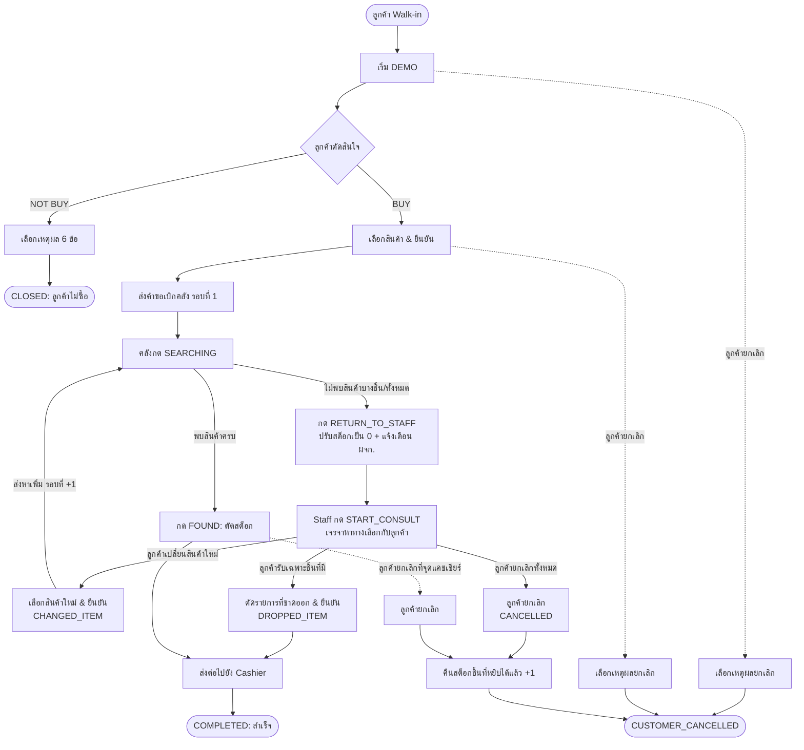

# แผนภาพเส้นทางการใช้งานระบบ (Service Efficiency System Journey Map)

เอกสารฉบับนี้อธิบายลำดับขั้นตอนการเดินทางของลูกค้า (Customer Journey) และการส่งต่องานระหว่างบทบาทต่าง ๆ (Cross-functional User Journey) ภายในระบบ **Service Efficiency System (SES)** พร้อมจุดบันทึกเวลา Server Timestamps และกรณีข้อยกเว้นทั้งหมด

---

## 1. แผนภาพรวมการทำงาน (End-to-End Workflow Diagram)

---

## 2. ลำดับขั้นตอนตามช่วงเวลา (Journey Phasing)

### Phase 1: การรับลูกค้าและการสาธิตสินค้า (Walk-in & DEMO)
* **ผู้ปฏิบัติงาน:** `STAFF`
* **เป้าหมาย:** สร้าง Session ทันทีที่ลูกค้าเข้าร้าน และจับเวลาช่วงที่พนักงานให้คำแนะนำสินค้า
* **ขั้นตอนหลัก:**
  1. สร้าง Customer Session ทันที (`customer_walk_in_at`)
  2. เริ่มต้นพูดคุยและนำเสนอสินค้า (`demo_start_at`)
  3. สิ้นสุดการนำเสนอสินค้า (`demo_end_at`)
* **จุดสำคัญ:** พนักงาน 1 ท่านดูแลลูกค้าที่เปิด Session DEMO ได้ครั้งละ 1 รายเท่านั้น

---

### Phase 2: การบันทึกผลการตัดสินใจและการเลือกสินค้า (Decision & Selection)
* **ผู้ปฏิบัติงาน:** `STAFF`
* **เป้าหมาย:** บันทึกผลการตัดสินใจ และคีย์ข้อมูลความต้องการของลูกค้าอย่างละเอียด
* **ขั้นตอนหลัก:**
  1. **กรณี NOT BUY:** เลือกเหตุผล 1 ใน 6 ข้อ -> ปิด Session ทันที
  2. **กรณี BUY:**
     - ระบุเบอร์โทรศัพท์ลูกค้า 10 หลัก (ต้องผ่านการตรวจสอบก่อน)
     - เลือกสินค้าหลัก (Main Product: Category -> Model -> SKU) เฉพาะรายการที่มีสต็อก
     - เลือกอุปกรณ์เสริม (Accessories) พร้อมระบุจำนวนชิ้น
     - ระบุ On-top, สะสมแต้ม (Points), ตัดแต้ม (Burn Point) และวิธีการชำระเงิน (Payment)
  3. เข้าสู่หน้ายืนยันข้อมูล (Confirmation) และกดยืนยันคำสั่งซื้อ
* **จุดสำคัญ:** ส่งคำขอไปยังคลังเป็นรอบค้นหาที่ 1 (`search_cycle_count = 1`)

---

### Phase 3: การจัดเตรียมและเบิกจ่ายสินค้า (Fulfillment & Stock)
* **ผู้ปฏิบัติงาน:** `STOCK`
* **เป้าหมาย:** ค้นหาสินค้าจริงในคลังสาขา ตัดสต็อก และนำส่งไปยังแคชเชียร์
* **ขั้นตอนหลัก:**
  1. กดปุ่ม `SEARCHING` เมื่อเริ่มเดินค้นหาในคลัง (`stock_started_at`)
  2. **กรณีพบสินค้าครบ:** กดปุ่ม `FOUND` (`stock_found_at`) ระบบจะตัดสต็อกสาขาตามจำนวนที่หยิบ นำส่งแคชเชียร์ `SENT_TO_CASHIER`
  3. **กรณีสินค้าไม่พบ/ขาดสต็อก (Stock Return to Staff):**
     - มาร์คชิ้นที่ไม่พบ และกด `RETURN_TO_STAFF` (`stock_not_found_at`)
     - ระบบปรับสต็อกชิ้นที่ไม่พบเป็น 0 และส่ง Alert แจ้งเตือนผู้จัดการสาขา
     - สินค้าชิ้นที่หาเจอแล้วจะถูกล็อคไว้
     - งานจะเด้งกลับไปที่ Staff เพื่อเริ่มกระบวนการเจรจา (`staff_consult_start_at`)

---

### Phase 4: การตรวจสอบ เปิดบิล และส่งมอบสินค้า (Billing & Checkout)
* **ผู้ปฏิบัติงาน:** `CASHIER`
* **เป้าหมาย:** ตรวจสอบความถูกต้องของสินค้า เปิดบิลรับชำระเงิน และส่งมอบสินค้า
* **ขั้นตอนหลัก:**
  1. กดรับสินค้าที่จุดแคชเชียร์ `CASHIER_RECEIVED` (`cashier_received_at`)
  2. สแกนบาร์โค้ดเครื่อง `CASHIER_SCAN` (`cashier_scan_at`)
  3. เปิดบิลในโปรแกรมหลัก **FileMaker** และกด `BILL_OPENED` ใน SES (`bill_opened_at`)
  4. รับเงิน ส่งมอบสินค้าให้ลูกค้า และกด `COMPLETED` เพื่อจบกระบวนการอย่างสมบูรณ์

---

## 3. ตารางบันทึกเวลามาตรฐาน (Server Timestamp Tracking Matrix)

ระบบ SES บันทึกเวลาทั้งหมดโดยใช้ Server Time เป็นเกณฑ์มาตรฐาน (Client ไม่สามารถส่งเวลาเองได้):

| ลำดับ | ชื่อตัวแปร Timestamp | จุดที่เกิดการบันทึก (Trigger Action) | Role ผู้กดบันทึก | ประโยชน์ในการวิเคราะห์ KPI |
| :---: | :--- | :--- | :---: | :--- |
| 1 | `customer_walk_in_at` | กดรับลูกค้าสร้าง Session | Staff | เวลารอเริ่มต้น (Wait Time) |
| 2 | `demo_start_at` | กดเริ่มการสาธิตสินค้า (DEMO) | Staff | เวลาเริ่มการขาย |
| 3 | `demo_end_at` | กดสิ้นสุดการสาธิตสินค้า | Staff | ระยะเวลา DEMO Duration |
| 4 | `decision_at` | กดยืนยันผลการตัดสินใจ (BUY / NOT BUY) | Staff | ระยะเวลาการตัดสินใจของลูกค้า |
| 5 | `product_selection_start_at` | เริ่มต้นเลือกสินค้า (เมื่อเลือก BUY สำเร็จ) | Staff | เวลาเริ่มคีย์ข้อมูลคำสั่งซื้อ |
| 6 | `product_selection_confirmed_at` | กดยืนยันรายการสินค้าในหน้าสรุป พร้อมส่งคำขอเบิกสินค้าไปยังคลัง | Staff | เวลาที่ใช้ในการเลือกและยืนยัน และเป็นจุดเริ่มต้นรอบการเบิกคลัง |
| 7 | `stock_started_at` | พนักงานคลังกดเริ่มค้นหาสินค้า (SEARCHING) | Stock | เวลารอตอบสนองของคลัง (Queue Time) |
| 8 | `stock_found_at` | พนักงานคลังกดพบสินค้า (FOUND) | Stock | ระยะเวลาค้นหาและหยิบของ (Picking Time) |
| 9 | `stock_not_found_at` | พนักงานคลังกดส่งกลับเนื่องจากของขาด | Stock | **Search Loss Time** (เวลาที่เสียเปล่า) |
| 10 | `staff_consult_start_at` | พนักงานขายกดเริ่มเจรจาเสนอทางเลือก | Staff | เวลารอเข้ารองรับปัญหา (Consult Response) |
| 11 | `re_confirmed_at` | พนักงานขายกดยืนยันข้อสรุปใหม่กับลูกค้า | Staff | **Consultation Duration** (เวลาเจรจา) |
| 12 | `cashier_received_at` | แคชเชียร์กดปุ่มรับมอบสินค้า | Cashier | เวลาส่งต่องานระหว่าง Stock -> Cashier |
| 13 | `cashier_scan_at` | แคชเชียร์กดปุ่มสแกนบาร์โค้ดสินค้า | Cashier | เวลาตรวจสอบความถูกต้องสินค้า |
| 14 | `bill_opened_at` | แคชเชียร์กดปุ่มเปิดบิลในระบบ FileMaker | Cashier | เวลาในการเปิดบิลและรับชำระเงิน |
| 15 | `cancelled_at` | กดยืนยันยกเลิก Session (เมื่อเกิดการ Cancel) | Staff/Stock/Cashier | อัตราการสูญเสียลูกค้าและจุดที่ยกเลิก |

---

## 4. แผนภาพเส้นทางข้อยกเว้นและ Loop การส่งกลับ (Exception & Loop Journeys)

---

## 5. การวิเคราะห์ประสิทธิภาพเชิงลึก (Efficiency Analysis Metrics)

จากโครงสร้างข้อมูลและ Timestamps ทั้งหมด ระบบสามารถสร้างมิติการวิเคราะห์ (Analytics Dimensions) ได้แก่:

1. **Cycle-based Analysis:** วิเคราะห์เปรียบเทียบระยะเวลาระหว่างคำสั่งซื้อแบบ First-time Pass (รอบค้นหา = 1) เทียบกับคำสั่งซื้อที่มีการวน Loop (รอบค้นหา $\ge$ 2)
2. **Stock Discrepancy Impact:** ประเมินความเสียหายด้านเวลาและโอกาสทางการขายที่เกิดจากสต็อกหน้างานไม่ตรงกับระบบ
3. **Staff Negotiation & Retention Performance:** ประเมินทักษะของพนักงานขายในการพลิกสถานการณ์ (เปลี่ยนรุ่น/ตัดรายการ) เพื่อรักษาลูกค้าไว้ได้สำเร็จ
